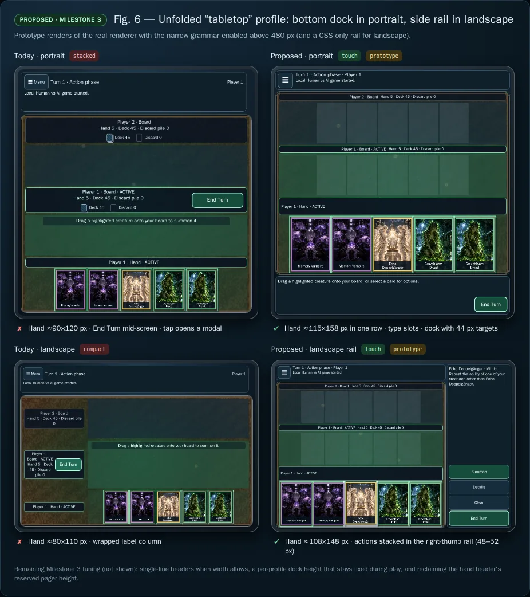

# Galaxy Z Fold4 touch-first UI uplift plan

> [!IMPORTANT]
> This document is an implementation plan. Its
> [checklist](#implementation-checklist) records which milestones have landed;
> nothing here is evidence of device verification. Figures 1 and 2 show the
> build before the uplift. Figures 3–7 are design illustrations (mockups and
> prototypes), not screenshots of shipped behavior. No physical Galaxy Z Fold4
> was used; see [Evidence and limitations](#evidence-and-limitations).

## Summary

The browser game draws the table with Three.js/WebGL2 and its controls as
native HTML. Since PR #133, the Fold4 cover screen in portrait (width ≤ 480 CSS
px) has a dedicated `narrow` layout: a fixed top bar, type-grouped Board slots,
tap-to-select cards, and a fixed-height action dock. Every other Fold4 posture
falls back to layouts built for a mouse:

- The unfolded main screen uses `stacked` (portrait) or `compact` (landscape),
  with wrapped headers, End Turn in the middle of the table, no dock, no
  tap-to-select, and hand cards much smaller than the screen allows.
- The cover screen held sideways uses `compact`, which is unplayable at about
  882×232: headers overlap each other and End Turn, and the hand is clipped.
- Folding or unfolding crosses 480 CSS px and switches layout mid-game, which
  clears the selection and dock prompt and cancels any drag.
- On every posture, the dragged card is drawn inside the WebGL canvas beneath
  the HTML row headers and the instruction overlay. Chrome and the finger hide
  it, and nothing shows where it will land.

This plan fixes drag'n'drop and touch controls first (Milestones 1–2). Those
changes help every posture with the current layouts. It then scales the layout
across the folded and unfolded screens with one touch grammar and three shells
(Milestones 3–4): `narrow` for the cover screen, `dock` for the unfolded screen
in portrait, and `rail` for landscape.

## Status and decisions

Status: **approved** by @pompomon on 2026-11-10 (PR #143), together with the
working defaults in [Open questions](#open-questions). Each milestone lands as
its own pull request, stacked on the previous one. Device verification stays
pending until a maintainer checks a physical Galaxy Z Fold4.

The approved decisions are:

1. **One touch grammar on coarse-pointer screens.** Tap selects and the dock
   confirms, drag summons, and a long press peeks. Folding, unfolding, or
   rotating the device changes only the shell geometry. Mouse and keyboard
   behavior on desktop is unchanged.
2. **The dragged card renders above HTML chrome without a second WebGL
   context.** A 2D overlay draws the card's existing face canvas. WebGL2
   failure handling through `RendererHost` is unchanged, and no hidden
   renderer fallback is added.
3. **Release stays finger-based.** The lifted card is a visual offset only. The
   drop decision keeps using the pointer position, with touch slop that never
   extends toward the hand, which remains the cancel area.
4. **The shell is a pure function of the layout viewport and pointer type.** It
   never reads `visualViewport`, so the on-screen keyboard and pinch zoom
   cannot change the layout.
5. **Folding keeps the player's place.** The selection, dock prompt, and hand
   page survive a change between touch shells. A resize cancels a live drag
   cleanly and never submits it.
6. **The dock and rail have fixed per-shell sizes during play.** Prompt changes
   cannot re-measure Board rows and cancel a drag, which is why PR #133 fixed
   the dock height.
7. **The change is renderer-only.** Engine rules, controller contracts, saves,
   recordings, P2P, the CLI, and catalog copy are unchanged. Card names come
   from the existing catalog presentation helpers.
8. **Physical device verification is required.** Milestones 1–4 are not done
   until they are checked on a Galaxy Z Fold4 in each posture. Desktop
   emulation does not count as Android coverage.

## Implementation checklist

- [x] Plan — Record the analysis, proposed design, figures, and milestones
- [x] Approval — Maintainer approval of the plan and its working defaults
- [ ] Milestone 0 — Device baseline and pure shell classifier
  - [x] `threeShellProfile` in `layout.ts` with posture, boundary, pointer, and
    invalid-size tests; no callers yet
  - [ ] [Device measurements](#device-measurements) (pending maintainer:
    needs a physical Galaxy Z Fold4)
- [ ] Milestone 1 — Touch drag feedback above chrome
  - [x] `ThreeDragLayer`, `dropAccepts`, `dragProxyPlacement`, and
    `landingSlotRect`, with focused tests
  - [x] Landing label, instruction pill, row dimming, and the narrow dock
    prompt as the drag announcer
  - [x] Agent docs: drag layer ownership, instruction placement, and the dock
    announcer
  - [ ] Fold4 device check of Figure 3, callouts 1–5 (pending maintainer:
    needs a physical Galaxy Z Fold4)
- [ ] Milestone 2 — Long-press peek, multi-touch policy, and edge auto-scroll
  - [x] `peeking` drag phase, ring, `peekPlacement`, and the decorative peek
    with its dock announcement, with focused tests
  - [x] Multi-touch policy, the second-finger guard, and touch context-menu
    and callout suppression
  - [x] Edge auto-scroll, near-lane anchoring, and a hand page that follows
    the selection
  - [x] Agent docs and README: pointer policy, peek, and auto-scroll
  - [ ] Fold4 device check of Figure 4, callouts 1–4, and the second-finger
    policy (pending maintainer: needs a physical Galaxy Z Fold4)
- [ ] Milestone 3 — Unfolded `dock` and `rail` shells with fold continuity
  - [x] Shell wiring: `threeShellProfile` on `resize` and `(pointer: coarse)`
    changes, `data-shell` and `data-shell-short` on the root, and the dock in
    every touch shell, with focused tests
  - [x] Per-shell touch layout with card maxima and a pager row only for a
    multi-page hand; the cover-screen geometry is unchanged
  - [x] `touchShellActive()`, keeping the selection, dock prompt, and target
    list across touch shells
  - [x] `[data-shell]` CSS for the `dock` and `rail` shells, with safe-area
    fallbacks
  - [x] Agent docs and README: touch shells, fold continuity, tap-select, and
    the dock
  - [ ] Fold4 device check of Figures 5 and 6 (pending maintainer: needs a
    physical Galaxy Z Fold4)
- [ ] Milestone 4 — Short landscape (cover screen and phones held sideways)
  - [x] Short-rail CSS: the top bar heads the rail, the board takes the full
    height beside it, and the dock wraps its actions and scrolls at large
    text sizes
  - [x] A 44 px paged hand strip, a sideways lift (`preferSide`) that leaves
    the landing ghost in view, and a near-lane anchor that keeps the hand in
    view, with focused tests
  - [x] 882×232 and 844×390 geometry at 100% and 200% text, and a summon and
    a cancel after edge auto-scroll
  - [x] Agent docs and README: the short rail
  - [ ] Fold4 device check of Figure 7 (pending maintainer: needs a physical
    Galaxy Z Fold4)
- [ ] Milestone 5 — Documentation, hardening, and device release gate
  - [x] Drag geometry measured on the first move and reused by later moves,
    edge auto-scroll steps, and the release until something may move the
    stage, with read-counting tests
  - [x] The `narrow` dock's action row grows with End Turn, so its
    three-line prompt stays whole at 200% text
  - [x] Final pass over the README controls and agent docs, and the
    [Fold4 posture check](../agent/testing.md#fold4-posture-check) in
    `testing.md`
  - [x] Posture sweep in Chromium touch emulation at 100% and 200% text and
    with reduced motion
  - [ ] Remote drag profiling in each shell and quality tier, TalkBack,
    maximum font and display size, and Remove animations (pending
    maintainer: needs a physical Galaxy Z Fold4)
  - [ ] [Fold4 device checklist](#fold4-device-checklist) (pending
    maintainer: needs a physical Galaxy Z Fold4)

Each milestone is a separately reviewable change. It includes its own focused
tests and agent-doc updates, and it leaves the repository passing the required
[validation sequence](../agent/validation-and-build.md#sequence).

Dependencies:

- Milestones 1 and 2 improve today's `narrow`, `stacked`, and `compact`
  layouts and do not need Milestone 3.
- Milestone 3 depends on Milestone 0.
- Milestone 4 depends on Milestones 2 and 3.

## Fold4 postures

| Posture | Approximate CSS viewport | Today (`data-layout`) | Proposed shell |
| --- | --- | --- | --- |
| Cover screen, portrait | 344×770 Chrome tab; ≈344×834 installed PWA; 344×882 screen | `narrow` | `narrow` |
| Cover screen, landscape | ≈882×232 Chrome tab | `compact`, unplayable | `rail`, short |
| Main screen, portrait | ≈690×717 Chrome tab; ≈690×829 screen | `stacked` | `dock` |
| Main screen, landscape | ≈829×578 Chrome tab; ≈829×690 screen | `compact` | `rail` |

These sizes are estimates. They come from the panel resolutions (cover 904×2316
and main 1812×2176 device pixels) at a device pixel ratio of about 2.625, minus
typical browser chrome. The main-screen CSS width varies from about 673 to 786
px with Android's screen zoom setting. Milestone 0 replaces the estimates with
measurements.

### Device measurements

**Pending maintainer verification.** No physical Galaxy Z Fold4 has been
available, so every value below is still unmeasured. The `threeShellProfile`
tests use the estimates above. When a posture is measured, update this table,
the postures table, and the posture fixture in `src/test/three-layout.test.ts`
together.

Run the diagnostic from
[Milestone 0](#milestone-0--device-baseline-and-pure-shell-classifier) in each
posture, first as shown and then with the keyboard open, after a pinch zoom,
and with the URL bar hidden. The index page does not set `interactive-widget`,
so Chrome's default should resize only the visual viewport for the keyboard;
the last column records whether `inner` changed.

| Posture | Context | `inner` | `visual` | DPR | `screen` | `coarse` / `anyCoarse` / `hoverNone` | `inner` changes (keyboard, zoom, URL bar) |
| --- | --- | --- | --- | --- | --- | --- | --- |
| Cover portrait | Chrome tab | Pending | Pending | Pending | Pending | Pending | Pending |
| Cover portrait | Installed PWA | Pending | Pending | Pending | Pending | Pending | Pending |
| Cover landscape | Chrome tab | Pending | Pending | Pending | Pending | Pending | Pending |
| Cover landscape | Installed PWA | Pending | Pending | Pending | Pending | Pending | Pending |
| Main portrait | Chrome tab | Pending | Pending | Pending | Pending | Pending | Pending |
| Main portrait | Installed PWA | Pending | Pending | Pending | Pending | Pending | Pending |
| Main landscape | Chrome tab | Pending | Pending | Pending | Pending | Pending | Pending |
| Main landscape | Installed PWA | Pending | Pending | Pending | Pending | Pending | Pending |

| Gesture observation | Cover screen | Main screen |
| --- | --- | --- |
| A resting thumb makes the next touch non-primary | Pending | Pending |
| A long press on the board fires `contextmenu` | Pending | Pending |
| A long press selects row-label text or opens a system menu | Pending | Pending |

## Current baseline

How to read the figures:

- **Badges.** `narrow`, `stacked`, and `compact` are today's `data-layout`
  values. `touch` marks the proposed shared touch grammar.
- **Current** figures are real renders of `2f8e15f`, with callouts added.
- **Mockup** figures draw proposed elements as HTML overlays on real renders.
- **Prototype** figures run the production build with a test-only injected
  script, not committed. The script forces the narrow grammar above 480 px or
  applies a CSS-only rail.

Sizes in figure labels are estimates.


*Figure 1 — Current build (`2f8e15f`) in four Fold4 postures, with three layout
grammars:*

- *Cover portrait uses `narrow`. The dock, type slots, and tap-select work, but
  drag feedback is weak.*
- *Main portrait uses `stacked`. The HUD takes about 125 px, headers wrap to
  three lines, and End Turn sits mid-screen. There is no dock or tap-select,
  and hand cards are about 90×120 where about 115×158 would fit.*
- *Main landscape uses `compact`. The label column wraps to five lines and hand
  cards are about 80×110.*
- *Cover landscape uses `compact` and breaks. Headers overlap each other and End
  Turn, the hand is clipped to about 35 px wide, and the HUD takes 43% of the
  height.*

| Area | Current behavior | Gap to close |
| --- | --- | --- |
| Layout selection | `index.ts:82-85` and `index.ts:111` enable the narrow shell from `matchMedia('(max-width: 480px)')` (`layout.ts:43-45`). `compactBoardViewport` (`layout.ts:72-75`) picks `compact` when width ≥ 760, width > height, and height ≤ 740, using the `visualViewport` height (`board.ts:933-934`). Everything else is `stacked`. | One device shows three layout grammars, and a touch screen gets a mouse grammar. |
| Narrow shell | Fixed top bar and dock heights (`renderer.css:80-94`, rationale at `index.ts:46-47`) and five type slots (`layout.ts:47`, `layout.ts:246-251`). Hand-card taps select first and the dock offers Summon, Details, and Clear (`interface.ts:519-525`, `interface-model.ts:771-774`). | Works only at width ≤ 480 px. |
| Dragged card | `createProxy` (`card-registry.ts:310-319`) draws a lifted copy in the scene (z 60, scale 1.08, render order 1500 from `card-registry.ts:12`). Touch lifts it a fixed 44 px (`board.ts:736`). The canvas sits under the row labels (`graphics.css:28-32`, z-index 1) and the instruction (`graphics.css:123-126`, z-index 2). | Chrome and the finger hide the card (Figure 2, A). |
| Drop feedback | `moveDrag` tints the whole near lane (`board.ts:737-739`). The ghost meshes (`board.ts:141-142`) do not mark a landing slot. In `narrow`, the instruction appears only during a drag (`board.ts:394-396`), anchored over the near row (`board.ts:979-981`). | No landing cue (B), and the instruction covers the drop zone. The dock prompt ignores the drag (C). |
| Drop decision | Release summons when `containsDrop(clientX, clientY)` holds (`interaction.ts:287-292`), so the decision uses the finger rather than the lifted card. The drop rect is the near header plus lane (`layout.ts:231-241`), with no touch slop. `containsDrop` (`board.ts:708-712`) and `moveDrag` (`board.ts:737`) each repeat the allowed-card test. | Keep finger-based release. Add slop and one shared predicate so highlight and release cannot disagree. |
| Card inspection | The hover preview is mouse-only (`interaction.ts:243-260`). A tap selects in `narrow` (`interface.ts:519-525`) and otherwise opens the modal preview (`interface.ts:526`, `interface.ts:540-551`). | Reading a card on touch costs a modal round trip or a selection. |
| Interceptions and targets | In `narrow`, a touch tap on an eligible Interception card or Board target selects it and the dock confirms (`interface.ts:493-518`). Other layouts act on the tap immediately. | Main-screen touch users get no confirmation step. |
| Multi-touch | `onPointerDown` ignores `isPrimary === false` (`interaction.ts:168-169`). `activatePrimary` cancels any drag through `onResize()` and then submits (`board.ts:694-700`). | A resting thumb makes the next touch non-primary, so it is ignored. A second finger can press End Turn mid-drag. |
| Resize and fold | Entering or leaving `narrow` ends the drag and resets the hand page (`board.ts:331-339`), and leaving `narrow` clears the selection (`interface.ts:360-364`). Within `narrow`, a resize that changes the page size clears a selected card that is no longer on the visible page (`board.ts:433-435`, `board.ts:493`, `interface.ts:243-249`). | Unfolding loses the player's place (Figure 5, today). |
| Unfolded sizing | The stacked HUD row is `clamp(96px, 16dvh, 144px)` (`renderer.css:17`), and headers wrap to three lines. Hand cards are about 90×120 CSS px on the main portrait screen, where about 115×158 fits. | Space is wasted and End Turn is far from the thumb. |
| Short landscape | At about 882×232, `compact` overlaps headers and End Turn, clips hand cards to about 35 px wide, and gives the HUD 43% of the height. | Unplayable. |
| Player docs | README describes the stacked grammar ("tapping opens a preview") and does not mention the narrow dock. | Describe the touch grammar. |


*Figure 2 — Current touch drag on the folded and unfolded screens (current
renders with callouts):*

- *(A) Chrome hides the lifted card: the near header and the "Release to
  summon" band, which wraps to three lines on the main screen.*
- *(B) The whole lane glows the same, with no landing-slot cue.*
- *(C) On the cover screen, the dock prompt does not reflect the drag. The main
  screen has no dock.*

Relevant implementation seams:

- `src/renderers/three/interaction.ts` — pointer gestures and release
  decisions.
- `src/renderers/shared/drag-state.ts` — gesture phases and thresholds
  (`TOUCH_DRAG_THRESHOLD_PX` is 12).
- `src/renderers/three/board.ts` — drag proxy, highlights, instruction overlay,
  and applying layouts.
- `src/renderers/three/layout.ts` — pure geometry and viewport
  classification.
- `src/renderers/three/card-registry.ts` and `assets.ts` — retained cards and
  face-texture canvases.
- `src/renderers/three/interface.ts` and `interface-model.ts` — selection,
  dock, previews, and native actions.
- `src/renderers/three/index.ts`, `renderer.css`, and `graphics.css` — shell
  wiring and CSS.

## Goals

- Make touch drag'n'drop legible and forgiving on both screens. The lifted
  card, its landing slot, the drop zone, and the cancel area stay visible.
- Give touch players a quick, non-modal card peek that cannot select or submit
  by accident.
- Use one touch grammar on every coarse-pointer posture, so muscle memory
  carries over when the device is folded, unfolded, or rotated.
- Use the unfolded screen's space: hand cards of at least 108×148 CSS px,
  Board slots of about 85×117, single-line headers, and actions within thumb
  reach.
- Keep the player's place when the device is folded, unfolded, or rotated.
- Keep touch targets at least 44 CSS px and live regions persistent. Keep every
  action reachable by keyboard and screen reader.
- Keep rendering cost flat: no per-frame DOM measurement, no second WebGL
  context, and no `structuredClone(GameState)` in render paths.

## Non-goals

- Changes to rules, AI, legality, saves, recordings, P2P, the CLI, or catalog
  copy.
- Flex mode (half-folded) layouts or the Viewport Segments API; see
  [Open questions](#open-questions).
- New artwork, a card-face redesign, audio, or haptics.
- A second renderer, a second WebGL context, or a hidden non-WebGL fallback.
- Changes to mouse behavior or the `desktop` layouts, apart from the shared
  drop predicate and the layout-viewport fix.
- Redesigning the lobby, Adventure hub, or menus, unless the shell grid
  requires it.

## Target design

### Shell profiles

`threeShellProfile({ width, height, coarse })` is a pure function in
`layout.ts`. It reads the layout viewport (`innerWidth` and `innerHeight`) and
`matchMedia('(pointer: coarse)')`, and returns `{ profile, short }`. The first
matching rule wins:

| Rule | Condition | Profile |
| --- | --- | --- |
| 1 | Width or height is not a finite positive number | `desktop` |
| 2 | Width ≤ 480 | `narrow` (unchanged breakpoint) |
| 3 | The primary pointer is not coarse | `desktop` |
| 4 | Width > 1024 and height > 480 | `desktop` |
| 5 | Width > height | `rail`; `short` when height ≤ 480 |
| 6 | Otherwise | `dock` |

- Rule 2 keeps today's narrow behavior for every pointer type. Narrow desktop
  windows and the existing tests are unaffected.
- Rule 5 splits on orientation rather than an aspect-ratio threshold. Even at
  the most square main-screen postures, a card-size model favors `rail` at
  829×690 (landscape) and `dock` at 690×717 (portrait).
- No hysteresis is needed. The inputs do not depend on the shell, so a shell
  change cannot cause another reclassification. Milestone 0 confirms on device
  that the inputs stay stable when the keyboard opens, on pinch zoom, and while
  the URL bar moves.
- `desktop` keeps today's `stacked` and `compact` layouts.

| Shell | Board geometry | Hand card (CSS px, 100% text) | Actions |
| --- | --- | --- | --- |
| `narrow` | Today's narrow layout | ≈91×124 (unchanged) | Bottom dock with three prompt lines (unchanged) |
| `dock` | Narrow grammar with ≈85×117 slots and single-line headers | At least 108×148; target ≈115×158 | Bottom dock with two prompt lines and 44 px buttons |
| `rail` | Narrow grammar beside a right-hand rail | At least 108×148 | Rail `clamp(180px, 26vw, 240px)` wide with 48–52 px buttons |
| `rail`, short | Scrollable board and a one-line hand strip | At least 44 px wide | The rail also holds the HUD and End Turn |

### Touch interaction contract

| Input | Touch shells (`narrow`, `dock`, `rail`) | `desktop` |
| --- | --- | --- |
| Tap a hand card | Selects it; the dock offers Summon, Details, and Clear | Unchanged: opens the preview |
| Tap an eligible Interception card or Board target | Selects it; the dock confirms | Unchanged: acts immediately |
| Touch or pen press held ≈450 ms within 12 px | Opens a non-modal peek; release closes it without selecting or submitting | Same for touch and pen; the mouse keeps hover |
| Drag a summonable card past 12 px | The card lifts above chrome with a landing ghost and drop highlight. Release in the drop zone summons; release anywhere else, including over the hand, cancels | Touch and pen get the lift and slop; the mouse is unchanged (centered card, no slop) |
| Second finger while idle | May start a gesture even though it is not the primary pointer | Same |
| Second finger during a press or peek | Replaces the stationary gesture | Same |
| Second finger during a drag | Ignored; dock and End Turn buttons are inert | Same |
| Keyboard and screen reader | Dock buttons, Details, and Game Menu → Cards (unchanged) | Unchanged |

### Drag feedback

- **Drag layer.** An `aria-hidden` overlay inside `.three-stage`, layered above
  `.three-board-stage`, holds one card canvas and one landing label. It sets
  `pointer-events: none`. At drag start it draws the card's face canvas from
  the texture cache once (`assets.ts:218-256`), so the visual style and
  Monochrome match. During the drag it changes only a CSS transform.
- **Placement.**
  - Mouse: centered on the pointer at scale 1.08, as today.
  - Touch and pen: scale 0.9, lifted `clamp(cardHeight / 2 + 20, 44, 120)` px
    above the finger and clamped to the visible stage with a 4 px margin. When
    there is no room above, the card moves beside the finger and stays on that
    side while it fits.
- **Landing ghost.**
  - Touch shells: the ghost marks the card's type slot in the near row
    (`typeSlotX(typeSlot(card))`). It is labelled "Lands here", or "+1" when
    the slot already holds a card.
  - `desktop`: the ghost marks the `cardSlotX` append position.
  - Both reuse the ghost meshes (`board.ts:141-142`).
- **Drop zone.**
  - The near header and lane are outlined while the drop is accepted.
  - Touch and pen get 12 px of slop on the top and side edges, never on the
    edge facing the hand.
  - Highlights change only color, outline, or opacity, so measured header
    sizes cannot change mid-drag.
- **Instruction.** During a drag, the instruction moves from the near row to a
  pill at the top of the visible stage, outside the drop zone. Figure 3 shows
  the proposed accepted-state copy: "Release to summon · back to hand cancels".
  The idle hint stays at the near row.
- **Dock mirror.** In shells with a dock, the persistent dock prompt describes
  the drag, for example: "Summon Echo Doppelgänger: release anywhere on your
  board. Drag back to your hand to cancel."
  - The board instruction is quiet there (`aria-live="off"`, set before the
    text changes), so each message is announced once.
  - On `desktop`, the board instruction stays the live region.
- **Context.** Rows that cannot accept the card dim. The source card stays at
  0.35 opacity as a placeholder (`board.ts:724`). The pill switches to cancel
  copy while the finger is over the hand.
- **Reduced motion.** The return-to-hand animation is skipped. The lift and
  ghost remain because they are functional, not decorative.

### Long-press peek

- **Trigger.** A touch or pen press held for 450 ms within the 12 px drag
  threshold. The card must have a preview (`threePreviewCard`,
  `interface-model.ts:234-241`) that `canPreviewCard` (`card-preview.ts:16`)
  allows, which includes eligible Interception cards. Peek uses the same
  projection as hover and Details, so it reveals nothing the view model hides.
  A ring appears after about 150 ms, so quick taps show nothing.
- **Rendering.** The peek reuses the hover preview path (`interface.ts:266-283`
  and `renderThreeHover` at `interface-model.ts:667-670`), with the same catalog
  copy as Details. A pure `peekPlacement()` places it on the half of the stage
  away from the finger, scaled to the shell, and never over the held card.
- **Release and movement.** Releasing closes the peek without a tap, so a long
  press on an Interception card can never intercept. Moving past the threshold
  closes the peek and, for a summonable hand card, starts a drag.
- **Closing.** The peek closes on `pointercancel`, blur, `visibilitychange`, a
  decision change, relayout, opening a menu, and disposal.
- **Announcement.** The dock prompt announces the peek once. The preview stays
  `aria-hidden`, and Details remains the keyboard and screen-reader path.
- **Fallback.** Where a peek is unavailable, a held press keeps today's tap
  behavior, so slow taps still work.

### Fold continuity

- **Selection.** The selected card, target, and discard, and the open target
  list, persist across `narrow`, `dock`, and `rail`. Entering `desktop` clears
  them, as leaving `narrow` does today, and decision changes still clear them.
- **Hand page.** After a shell or page-size change, the hand page follows the
  selection (`floor(selectedIndex / pageSize)`) instead of resetting to the
  first page, so the selected card stays visible and is not cleared. A new
  acting player or a presentation boundary still resets the page
  (`board.ts:314-318`).
- **Scroll.** After relayout, the stage scroll keeps the near lane in view.
- **Live drag.** A drag in progress is cancelled whether `resize` arrives
  before or after `pointercancel`. Capture is released, any peek closes, the
  source card returns, and nothing is submitted.

## Atomic milestones

### Milestone 0 — Device baseline and pure shell classifier

**Scope**

- Measure each posture on a Galaxy Z Fold4 with current Chrome stable, in a tab
  and as an installed PWA. Use remote debugging (`chrome://inspect`) to run:

  ```js
  JSON.stringify({ inner: [innerWidth, innerHeight], visual: [visualViewport?.width, visualViewport?.height], dpr: devicePixelRatio, screen: [screen.width, screen.height], coarse: matchMedia('(pointer: coarse)').matches, anyCoarse: matchMedia('(any-pointer: coarse)').matches, hoverNone: matchMedia('(hover: none)').matches })
  ```

- Repeat with the keyboard open, after a pinch zoom, and with the URL bar
  hidden. Record whether `innerWidth` and `innerHeight` change.
- Confirm that a thumb resting on the screen makes the next touch non-primary.
  Record whether a long press on the board fires `contextmenu`, selects label
  text, or opens a system menu.
- Add `threeShellProfile` and its types to `layout.ts`, with no callers yet.
- Replace the estimates in [Fold4 postures](#fold4-postures) with the
  measurements.

**Primary modules**

- `src/renderers/three/layout.ts`
- `src/test/three-layout.test.ts`
- This document

**Required tests**

- Each measured posture, including the keyboard-open variants, maps to the
  shell in the postures table.
- Boundaries: widths 480/481 and 1024/1025, heights 480/481, square
  viewports, and fine and coarse pointers.
- Zero, negative, `NaN`, and `Infinity` sizes return `desktop`.

**Definition of done**

- The measurements are recorded here, and maintainers approve or amend the
  proposed decisions.
- No runtime behavior changes.

### Milestone 1 — Touch drag feedback above chrome


*Figure 3 — Proposed (mockup on the cover screen, prototype on the main
screen). The numbers match the callouts in the figure:*

1. *The drag layer draws the card above chrome at 90% scale with a slight tilt
   and shadow.*
2. *The lift adapts to the card and is clamped to the stage.*
3. *A "Lands here" ghost marks the landing slot.*
4. *The drop zone and near header are outlined, with touch slop.*
5. *The instruction pill sits at the stage edge, outside the drop zone.*
6. *Rows that cannot accept the card dim.*
7. *The source card stays as a placeholder; releasing over the hand cancels.*
8. *The dock prompt mirrors the drag in its live region.*

**Scope**

1. **Drag layer.** Add `src/renderers/three/drag-layer.ts`.
   - `ThreeBoard` creates the layer once, mounts it in `.three-stage` after
     `.three-board-stage`, and disposes it with the board.
   - At drag start the layer acquires a lease on the dragged card's face
     texture and draws the canvas once. It releases the lease on drop, cancel,
     pointer loss, relayout, and disposal.
   - The in-scene proxy is hidden while the layer is visible. If
     `getContext('2d')` fails, the in-scene proxy stays, as today.
2. **Pure helpers.** Add `dragProxyPlacement()` (using the shared `clamp`),
   `landingSlotRect()`, and `dropAccepts()` to `layout.ts`. Map board units to
   stage pixels with the same mapping as picking (`clientToBoard`,
   `layout.ts:341-355`), including the stage scroll offset.
3. **One predicate.** Use `dropAccepts()` in both `moveDrag`
   (`board.ts:731-742`) and `containsDrop` (`board.ts:708-712`). The release in
   `interaction.ts:287-292` stays finger-based.
4. **Landing ghost.** Show it with the existing ghost meshes and the drag
   layer's label.
5. **Instruction and highlight.**
   - During a drag, move the instruction to the top of the visible stage. Write
     its text only when the accepted state changes.
   - Mark the accepted near header with a data attribute that is styled with
     outline and background only.
6. **Dock mirror.**
   - `ThreeBoard` reports drag start, accepted-state changes, and drag end to
     `ThreeInterface` through a new callback wired in `index.ts`.
   - `interface-model.ts` projects the dock text from catalog names and
     restores the previous prompt when the drag ends.
   - In shells with a dock, set the board instruction to `aria-live="off"`
     before writing drag text.
7. **Dimming.** Dim rows that cannot accept the card through the lane colors
   (`board.ts:738-739`) and label CSS.

**Primary modules**

- `src/renderers/three/drag-layer.ts` (new)
- `src/renderers/three/board.ts`, `layout.ts`, `interaction.ts`,
  `card-registry.ts`, and `assets.ts`
- `src/renderers/three/interface.ts`, `interface-model.ts`, `index.ts`, and
  `graphics.css`
- `src/test/three-drag-layer.test.ts` (new), `three-layout.test.ts`,
  `three-interaction.test.ts`, `three-interface.test.ts`,
  `three-board-retention.test.ts`, and `three-renderer.test.ts`

**Required tests**

- **`dropAccepts`.** Slop applies to touch and pen, on the top and side edges
  only. No point in the hand rect is accepted, and the mouse gets no slop. A
  sampled grid shows that highlight and release agree everywhere.
- **`dragProxyPlacement`.** Cover:
  - the 44 and 120 px lift bounds;
  - clamping at all four stage edges with the 4 px margin;
  - the sideways fallback and side stickiness;
  - scroll offsets;
  - unchanged mouse placement.
- **`landingSlotRect`.** Each type slot in `narrow`, the "+1" state, and the
  append position in `stacked` and `compact`.
- **Drag layer.**
  - Each drag takes one lease and releases it on every end path and on
    disposal; repeated drags leak nothing.
  - A missing 2D context keeps the in-scene proxy.
  - Reduced motion skips the return animation.
- **Release.** Release over the hand, outside the stage, after
  `pointercancel`, or after relayout never submits. Release in the slop band
  submits once.
- **Dock and announcements.**
  - The dock prompt mirrors the drag, restores afterwards, and does not change
    the dock height.
  - The instruction text is written only on transitions.
  - Each message is announced once per shell: by the dock prompt (with the
    board instruction quiet) in shells with a dock, and by the board
    instruction (`role="status"`) on `desktop`.
- **Stateful UI.** Run the
  [stateful UI regression matrix](../agent/testing.md#stateful-ui-regression-matrix).
  A synchronous notification during the drop keeps the newer decision, and a
  rejected drop keeps a still-legal selection.

**Definition of done**

- On both Fold4 screens, the lifted card, landing ghost, and instruction stay
  visible above chrome and the finger (Figure 3, callouts 1–5).
- [`three-renderer.md`](../agent/three-renderer.md#layout) records where the
  instruction goes during a drag and who owns the drag layer.
- [`three-interface.md`](../agent/three-interface.md#status-announcements)
  records the dock prompt as the drag announcer.

**As built**

The implementation differs from the scope above in these ways:

- The drag layer is mounted inside `.three-board-stage`, not after it. It
  scrolls with the board, so its pixels are board units and need no scroll
  offset.
- The landing slot is its own mesh, drawn above cards, rather than a reused
  type-slot ghost. That way it also marks the append slot in `stacked` and
  `compact`.
- Mouse drags use the layer too, at the unchanged mouse placement, so the
  lifted card stays above the headers for every pointer.
- `card-registry.ts` and `assets.ts` are unchanged. The board takes the extra
  lease through `ThreeAssets.acquireCard`.
- Two existing issues are fixed along the way. Reduced motion no longer ends a
  live drag; only the return animation is skipped. And the end of a drag
  restores the current idle instruction, such as a response prompt, instead
  of the summon text.
- Only `narrow` has a dock in this milestone. Milestone 3 extends the quiet
  board instruction to every shell with a dock.
- From review: touch placement reserves the measured pill band, so the pill
  never covers a touch card. A stage `scroll` listener keeps the pill and the
  card in place when the board scrolls mid-drag. Artwork that loads under a
  still finger repaints the lifted card on the next board frame.

### Milestone 2 — Long-press peek, multi-touch policy, and edge auto-scroll


*Figure 4 — Proposed (mockup). The numbers match the callouts in the figure:*

1. *Holding for about 450 ms without moving 12 px fills a ring. Moving earlier
   starts a drag.*
2. *The peek opens away from the finger, scales with the screen, and never
   covers the held card.*
3. *It shows catalog copy, here Memory Vampire's Drain Memory: "Choose one card
   from your opponent's hand for them to discard." Release closes it without
   selecting.*
4. *The dock prompt announces the card. Details remains the keyboard path.*

**Scope**

1. **Peek.**
   - Add a `peeking` phase with an injected timer to `DragStateMachine`
     (`drag-state.ts`), and implement [Long-press peek](#long-press-peek).
   - Add `peekPlacement()` to `layout.ts`.
   - Prevent `contextmenu` for touch on the board canvas. Set
     `-webkit-touch-callout: none` and `user-select: none` on board labels
     during a game.
2. **Multi-touch.**
   - When idle, accept a touch or pen `pointerdown` regardless of `isPrimary`
     (`interaction.ts:168-169`).
   - Let a new pointer replace a pressed or peeking gesture, releasing the old
     pointer's capture. Ignore new pointers during a drag.
   - Inject a `dragActive()` guard at the entry of the native click dispatcher
     (`handleClick`, `interface.ts:854`). That dispatcher routes `play`
     (`interface.ts:909`) and the dock's `select-summon` (`interface.ts:916`).
     Add the same guard to `activatePrimary` (`board.ts:694-700`).
   - Do not fold that guard into `isBlocked()` or `nativeActionBlocked()`.
     `playCard` checks `nativeActionBlocked()` (`interface.ts:473`), so the
     guard would reject the drop itself.
3. **Edge auto-scroll.**
   - Trigger: the stage is scrollable (`board.ts:955-959`) and the finger is
     within 48 px of the visible top or bottom edge during a drag.
   - Scroll in `requestAnimationFrame` steps at up to about 600 px/s, scaled by
     how deep the finger is in the band.
   - After each step, refresh the cached canvas bounds and rerun `moveDrag`
     with the last pointer position.
   - Stop on release, cancel, relayout, and disposal.
4. **Relayout hygiene.**
   - Keep the hand page on the selected card after a profile switch
     (`board.ts:331-339`) or a page-size change (`board.ts:422-425`), instead
     of resetting or clamping it. The reset for a new acting player or a
     presentation boundary (`board.ts:314-318`) stays.
   - Anchor the stage scroll to the near lane.
   - Cancel a drag cleanly whichever of `resize` and `pointercancel` arrives
     first.

**Primary modules**

- `src/renderers/shared/drag-state.ts`
- `src/renderers/three/interaction.ts`, `board.ts`, and `layout.ts`
- `src/renderers/three/interface.ts`, `interface-model.ts`, and `graphics.css`
- `src/test/drag-state.test.ts`, `three-interaction.test.ts`,
  `three-interface.test.ts`, `three-layout.test.ts`, and
  `three-renderer.test.ts`

**Required tests**

Use `withFakeTimers` or `installFakeTimerHooks` from
`src/test/helpers/timers.ts`.

- **Peek.**
  - A peek opens at 450 ms only if the pointer has not moved 12 px. Moving past
    12 px at 449 ms starts a drag and never opens a peek.
  - Cards without a preview, and contexts where `canPreviewCard` refuses, never
    open a peek.
  - Release after a peek does not select, preview, intercept, or submit. A
    quick tap behaves as today.
  - The peek closes on each listed boundary, and no timer fires after disposal.
  - `contextmenu` is prevented for touch on the canvas, and not for the mouse.
- **Pointers.**
  - A non-primary touch starts a gesture when idle.
  - A new pointer replaces a press or peek.
  - During a drag, a second pointer cannot activate dock buttons or End Turn,
    and stale pointer IDs are ignored.
  - A drop combined with a dock click or End Turn produces at most one accepted
    submission.
- **Auto-scroll.** Cover the speed profile and stop conditions, frame
  cancellation on disposal, the `moveDrag` rerun after each step, and no
  scrolling when the stage cannot scroll.
- **Relayout.** Relayout mid-drag, in both event orders, submits nothing and
  releases both the capture and the texture lease. The hand page follows the
  selection across profile and page-size changes, keeping the selection, and
  still resets for a new acting player.

**Definition of done**

- On device, peek, drag, and second-finger behavior match the
  [touch interaction contract](#touch-interaction-contract) on both screens.
- A long press never shows a system menu or selects text.
- [`three-renderer.md`](../agent/three-renderer.md#interaction) records the
  pointer policy, and README describes the long-press peek.

**As built**

The implementation differs from the scope above in these ways:

- During a game, callout and text-selection suppression covers the whole
  board stage, not only the board labels.
- A `contextmenu` that follows a touch or pen press is also prevented when
  the browser reports it as `mouse` or with no pointer type. A real
  right-click presses the mouse first, so it keeps its menu.
- The peek also closes on capture loss, Escape, and a refused preview. The
  full ring stays under the finger while the peek is open.
- On a stage shorter than two bands, each auto-scroll band is half the stage
  height, so the bands never overlap.
- With no selection, a page-size change keeps the first card of the old page
  in view instead of clamping the page.
- The cover-screen peek tile is about 114 px wide. The peek name therefore
  uses less padding and 13 px type, so "Doppelgänger" stays on one line.
- The peek panel clips instead of scrolling, so a peek opens only on a side
  where all of it fits. From the ring on, `ThreeInterface.peekFits()`
  measures a probe of the peek at each candidate placement. If neither side
  fits, no ring shows and the press stays a tap, as the
  [fallback](#long-press-peek) describes.
- The second-finger guard also covers the hand page buttons.
- The hand page follows a selection that Details or a menu hides. Closing
  them therefore keeps the card selected instead of clearing it as off-page.
- A narrow board held at its minimum height keeps its layout while the stage
  shrinks. Relayout therefore also tracks the stage's client box. When only
  the box changes, it ends the gesture and re-anchors the near lane.

### Milestone 3 — Unfolded `dock` and `rail` shells with fold continuity


*Figure 5 — Unfolding with a card selected (current renders and prototype).*

- *Today, crossing 480 px swaps `narrow` for `stacked`. The selection, dock
  prompt, and actions are cleared, and any drag is cancelled.*
- *Proposed, one touch grammar keeps Summon, Details, and Clear. Hand cards
  grow from about 91×124 to 115×158 CSS px, and Board slots from about 60×82 to
  85×117. The hand page follows the selected card instead of resetting to the
  first page.*



*Figure 6 — Proposed `dock` and `rail` shells on the unfolded main screen
(prototype).*

- *Portrait: one row of hand cards at about 115×158, type slots, and a bottom
  dock with 44 px targets.*
- *Landscape: hand cards at about 108×148, with actions stacked in a right-hand
  rail at 48–52 px.*
- *Both shells use single-line headers and a per-shell dock or rail size that
  stays fixed during play. The hand pager row appears only when the hand has
  more than one page.*
- *"Tabletop" in the figure title means the unfolded screen used flat. It does
  not mean Flex mode.*

**Scope**

1. **Shell wiring.** In `index.ts`:
   - Replace the narrow media query (`index.ts:82-85`) with `threeShellProfile`,
     evaluated on `resize` and on `(pointer: coarse)` changes.
   - Set `data-shell` and `data-shell-short` on the root.
   - Show the dock in every touch shell (`index.ts:117`).
   - Remove the listeners on unmount.
2. **Touch layout.** Generalize `narrowBoardLayout` (`layout.ts:196-243`) into
   a touch layout with per-shell parameters: slot and hand-card maxima, hand
   lines, and the header budget.
   - Keep the `narrow` parameters identical, so the cover-screen tests
     (`three-layout.test.ts:223-252` and `three-layout.test.ts:316`) pass
     unchanged.
   - Replace `ThreeBoardPresentation.narrow` with the shell profile, and keep
     `data-layout="narrow"` as the cover-screen geometry key.
3. **Touch grammar.** Rename `narrowActive()` (`interface.ts:229-231`) to
   `touchShellActive()`. Tap-select, `confirmsTaps`, Board selection
   highlights, and dock buttons then work in every touch shell.
4. **Selection.** Keep the selection and the open target list across touch
   shells. Clear them only when entering `desktop` (replacing
   `interface.ts:360-364`) or when the decision changes.
5. **`dock` shell.**
   - A fixed, rem-based dock with two prompt lines and 44 px buttons.
   - Single-line headers.
   - Reserve the hand pager height (`board.ts:947`, `graphics.css:258-263`)
     only when the hand has more than one page. The page count changes only
     with the hand size, never during a drag.
6. **`rail` shell.**
   - `grid-template-columns: minmax(0, 1fr) clamp(180px, 26vw, 240px)`, with
     the rail on the right.
   - The top bar stays above the board.
   - Actions are stacked at 48–52 px.
7. **CSS selectors.** Move the `@media (max-width: 480px)` rules
   (`graphics.css:238` onward) to `[data-shell]` selectors. Keep plain
   fallbacks before `env(safe-area-inset-*)`.
8. **Layout viewport.** Use the layout viewport instead of the `visualViewport`
   height for `compactBoardViewport` (`layout.ts:72-75`, `board.ts:933-934`).

**Primary modules**

- `src/renderers/three/index.ts`, `layout.ts`, `board.ts`, `interface.ts`, and
  `interface-model.ts`
- `src/renderers/three/renderer.css` and `graphics.css`
- `src/test/three-layout.test.ts`, `three-renderer.test.ts`,
  `three-interface.test.ts`, `three-card-preview-layout.test.ts`, and
  `three-native-html.test.ts`

**Required tests**

- **Shell wiring.**
  - Root attributes match every posture fixture.
  - Resize and pointer changes reclassify; a `visualViewport`-only change does
    not.
  - The listeners are removed on unmount.
- **Narrow regression.** The existing narrow tests pass without edits.
- **`dock` and `rail` geometry.** At 690×717, 690×829, 829×578, 829×690, and
  the Milestone 0 measurements:
  - At 100% text, hand cards are at least 108×148 and slots about 85×117.
  - At 200% text, every target stays at least 44 px.
  - The drop zone, slots, and hand do not overlap the dock or rail.
  - Stage sizes subtract chrome as `narrowStage()` does
    (`three-layout.test.ts:210`).
- **Fold continuity.**
  - The selection, dock prompt, and target list survive
    `narrow` ↔ `dock` ↔ `rail`.
  - Entering `desktop` and decision changes clear them.
  - The stateful UI matrix rows run across a shell change.
- **CSS.** Fixed dock and rail sizes per shell, `[data-shell]` selectors, and
  safe-area fallbacks.
- **Dock.** Unique IDs and focus order in every shell.

**Definition of done**

- On device, the main screen uses `dock` in portrait and `rail` in landscape at
  the target card sizes. Unfolding mid-decision keeps the selection
  (Figure 5).
- [`three-interface.md`](../agent/three-interface.md#mobile-layout) documents
  the shells and fold continuity.
- README describes tap-select and the dock.

**As built**

The implementation differs from the scope above in these ways:

- During a game, every touch shell sets `data-shell`, including `narrow`,
  which also keeps its `three-root--narrow` class. Outside a game the root
  has no `data-shell`, and the dock stays hidden.
- A change to the `visualViewport` alone does not reclassify, so the
  on-screen keyboard and pinch zoom keep the current shell.
- `TOUCH_CARD_MAXIMA` caps the type-slot and hand-card heights per shell.
  `dock` and `rail` therefore stop at about 85×117 slots and 115×158 hand
  cards.
- The 108×148 hand-card target holds for the five-card opening hand: about
  115×158 in `dock` at 690×717 and 113×155 in `rail` at 829×578. Larger
  hands stay on one row and shrink. In `dock` at 690×717, six cards are about
  107×147 and seven about 91×125.
- The stage's `data-layout` names the shell (`narrow`, `dock`, or `rail`).
  `narrow` stays the cover-screen geometry key.
- The rail gives its leftover height to the prompt. The target panel and the
  tutorial banner move clear of the rail.
- At 200% text, End Turn grows to 52 px. The `dock` action row grows with
  it, so the two-line prompt stays whole. The `narrow` dock keeps the fixed
  62 px allowance it had before this plan, so 8 px of its three-line prompt
  scrolls at 200% text.
  [Milestone 5](#milestone-5--documentation-hardening-and-device-release-gate)
  gives it the same growing action row.
- Entering `desktop` keeps a pending summon, as before this milestone. Its
  target picker reopens on `desktop` with no target chosen.
- Without a selection, a switch between touch shells keeps the browsed hand
  page, or the first card of that page when the page size changes. Entering
  or leaving `desktop` starts on the first page, because `desktop` shows the
  whole hand.
- In this milestone, a short rail (the cover screen or a phone held sideways)
  keeps the top bar above the board, which stays at its 356 px minimum and
  scrolls. [Milestone 4](#milestone-4--short-landscape) moves the top bar into
  the rail.
- The geometry tests estimate the single-line header heights. The browser
  evidence measures them.

### Milestone 4 — Short landscape


*Figure 7 — Proposed short-landscape `rail` on the cover screen held sideways
(mockup and prototype). The numbers match the callouts in the figure:*

1. *The card lifts sideways.*
2. *An edge band auto-scrolls the board.*
3. *The landing ghost stays visible in the scrolled drop zone.*
4. *The hand header becomes a one-line strip. The prototype still uses 50 px.*
5. *The rail carries the HUD, prompt, and End Turn.*

**Scope**

- When `short`, the rail carries the HUD, dock prompt, and End Turn, and the
  board takes the full height beside it.
- The hand header becomes a one-line strip no taller than its 44 px pager
  buttons.
- The stage scrolls vertically. Edge auto-scroll from Milestone 2 reaches the
  drop zone, and relayout anchors the near lane.
- The sideways lift from Milestone 1 becomes the usual placement, because there
  is no room above the finger.
- In this shell, fixed rem sizes replace the `dvh`-based HUD row.
- Phones held sideways also get this shell. Today they use `compact` or
  `stacked`.

**Primary modules**

- `src/renderers/three/layout.ts`, `board.ts`, `index.ts`, `renderer.css`, and
  `graphics.css`
- `src/test/three-layout.test.ts`, `three-renderer.test.ts`, and
  `three-interaction.test.ts`

**Required tests**

- 882×232 (Fold4 cover) and 844×390 (phone) fixtures:
  - Headers, End Turn, and the hand do not overlap.
  - Hand cards are at least 44 px wide.
  - Auto-scroll reaches the drop zone.
  - At 200% text, everything is still reachable by scrolling.
- A drag into the scrolled drop zone summons once, and a cancel over the hand
  still works after scrolling.

**Definition of done**

- On device, a full game can be played by touch alone on the cover screen in
  landscape.

**As built**

The implementation differs from the scope above in these ways:

- Milestone 3 already gave the top bar a fixed rem height
  (`--three-topbar-height`), so this milestone only moves it. In the short
  rail it heads the rail column at that height. The narrower column wraps the
  title onto two lines, so at 100% text one status line stays in view. As in
  the other touch shells, the top bar keeps its height rather than growing
  with the status. Longer statuses and larger text scroll the title and
  status together under the pinned menu and Hint buttons.
- The actions keep their 48 px height and wrap in rows. When large text
  outgrows the rail, the dock below the top bar scrolls as a whole, End Turn
  included, instead of clipping them. At 200% text on the cover screen, the
  top bar takes 112 of the column's 224 px, so End Turn starts below the
  dock's fold. With a card selected, the dock scrolls 137 px.
  [Milestone 5](#milestone-5--documentation-hardening-and-device-release-gate)
  keeps this arrangement and explains why.
- The near-lane anchor also keeps the whole hand in view, so a drag starts
  and lands without scrolling. When the near lane and the hand cannot both
  fit, the near header leaves the view first, then the top of the near lane.
  On the cover screen at 100% text, the anchor scrolls 132 of 136 px and the
  near lane's cards stay whole. At 200% text with a paged hand, about half of
  the near lane stays in view.
- At 844×390 the stage is 378 px tall, or 361 px with a notch and gesture
  bar. Both are above the 356 px minimum board, so at 100% text the board
  fits without scrolling.
- With `preferSide`, the card keeps its current side while it fits, then
  takes the only side that fits, then the roomier side, with ties going left.
  It goes above only when neither side fits but above does.
- A sideways card shares the near lane's rows with the landing ghost, so it
  first takes the only side that fits without covering the ghost. Near the
  ghost's centre both sides cover it, or neither does, so the card keeps its
  side there instead of flickering. Without this rule, a card dragged
  straight up from the hand hid the ghost at both 882×232 and 844×390.
- The 44 px paged hand strip applies only to the short rail. `dock` and the
  taller `rail` keep 50 px.
- The summon and cancel tests drive the real `ThreeInteraction` and
  `ThreeBoard` in `three-battlefield-controls.test.ts`, because
  `three-interaction.test.ts` uses a stub board that cannot scroll.

### Milestone 5 — Documentation, hardening, and device release gate

**Scope**

- Do a final pass over the README controls and the agent docs named in earlier
  milestones. Add the Fold4 posture matrix to
  [`testing.md`](../agent/testing.md#browser-verification-and-evidence).
- Profile drag frame times remotely in each shell and quality tier
  (`quality.ts:28`, `quality.ts:46-49`). Confirm that no per-frame DOM
  measurement or layout was added.
- Smoke-test dock announcements with TalkBack. Test maximum Android font and
  display size, and Remove animations.
- Run the [Fold4 device checklist](#fold4-device-checklist).

**Required validation**

1. Node 24 and a clean `npm ci`.
2. `npm run lint`.
3. `npm run test`, with the observed test count.
4. `npm run build`.
5. Secret scan of changed files.
6. `codeql_checker` after committing.
7. Production preview at the configured non-root base path.
8. Device checklist, recording interaction, capture, inspection, and
   attachment separately.

**Definition of done**

- Every acceptance criterion below is met, or explicitly blocked with
  maintainer follow-up. No required item is silently waived.

**As built**

The implementation differs from the scope above in these ways:

- A drag now measures its geometry once instead of on every pointer event.
  `ThreeBoard` caches the canvas box, the visible stage, and the scroll range
  when it first needs them, and tracks the stage's `scrollTop` itself. Moves,
  edge auto-scroll steps, and the release read the cache. Each stage scroll
  event reads `scrollTop` once. A page or ancestor scroll, a relayout, or a
  new presentation measures again. The release decides from the geometry
  behind the highlight, so a release at the last move's point does what the
  highlight shows, even before a pending scroll event arrives. A render or
  relayout that keeps the drag leaves the highlight until the next move or
  scroll, and a release in between measures afresh, as before this
  milestone.
  [Drag geometry](../agent/three-renderer.md#drag-geometry) has the details.
- Remote profiling needs the device, so it stays pending maintainer
  verification. Instead, a review of the drag path and a count of layout
  reads in Chromium touch emulation confirm that the finished stack adds no
  per-frame measurement. Before this milestone, every edge auto-scroll frame
  measured the board again. The count covers one touch drag that edge
  auto-scrolls at 882×232 and 100% text and summons, in each build. It sums
  box and scroll reads such as `getBoundingClientRect`, `clientHeight`, and
  `scrollTop`:

  | Phase | Before (`79d2daa`) | After |
  | --- | --- | --- |
  | Lift and 10 moves to the top band | 300 | 19 |
  | Held auto-scroll: 10 scroll events over about 23 frames | 347 | 10, all `scrollTop` |
  | 6 moves to the drop zone | 78 | 0 |
  | Release, ending the drag and laying out | 62 | 43 |

  Both builds also read `innerWidth` and `innerHeight` once per pointer
  event in `ThreeInteraction`. That check predates this plan. The board's
  frame loop and the drag layer read no layout.
- The `narrow` dock's action row now grows with End Turn, as the `dock`
  shell's has since Milestone 3. At 200% text on the cover screen, the stage
  gives up 8 px (472.5 instead of 480.5 px at 344×770), and the three-line
  idle prompt stays whole. Nothing changes at 100% text. A selected card's
  rules, a drag instruction, or "No creature can be summoned now" can still
  take four or five lines at 200% text. Those scroll inside the prompt,
  because the dock keeps a fixed height during play.
- The short rail keeps its Milestone 4 arrangement at 200% text. The top bar
  takes 112 of the column's 224 px, which leaves the dock 108 px after the
  gap. A two-line prompt (65 px), End Turn (52 px), and the dock's gaps,
  padding, and border need 143 px, so something has to scroll. The idle
  prompt needs four lines, so it also scrolls inside that two-line box.
  Scrolling the dock as a whole keeps End Turn at full size. A swipe reaches
  it, and Tab scrolls it into view. In the posture sweep, the fifth Tab with
  a card selected focused End Turn with its focus ring, the dock scrolled
  131 px, and the card stayed selected. The README says to scroll the rail
  there.
- The [Fold4 posture check](../agent/testing.md#fold4-posture-check) ran in
  Chromium touch emulation against the production preview at `/Cardgame/`,
  at 100% and 200% root font size. This is emulation evidence, not device
  coverage.
  - All five postures had the expected shell, no horizontal overflow, no
    overlap of the board, top bar, and dock, controls of at least 44×44 px,
    and one-line board headers. The board and dock boxes kept their sizes
    through each drag, peek, and selection.
  - All 10 tap-selects with Summon and all 10 drag summons summoned one
    card, and all 10 drags back to the hand summoned nothing. Each of the 20
    releases did what the highlight showed before it.
  - At 882×232, at both text sizes, holding a drag in the top band
    auto-scrolled the board from 132 px to its top, with the pill pinned to
    the visible top, and the drag then summoned.
  - Peeks opened above the finger in four postures. On the cover screen held
    sideways, the hand card's peek did not fit at either text size, so each
    held press stayed a tap, as the Milestone 2 fallback describes.
  - Resizing 344×770 to 690×717 to 829×578 kept a selection through
    `narrow`, `dock`, and `rail`, and cancelled a live drag at each step
    without a summon.
  - With reduced motion, a cancelled drag requested one animation frame after
    the release, against 6 to 19 frames without it.
- Remote profiling, TalkBack, maximum Android font and display size, Remove
  animations, and the [Fold4 device checklist](#fold4-device-checklist) need
  a physical Galaxy Z Fold4. They stay pending maintainer verification, and
  the acceptance status below shows which criteria wait on them.

**Acceptance status**

"Met" rests on the cited tests, the posture sweep above, and a review of the
stack's diff. Approved [decision 8](#status-and-decisions) still requires a
physical Galaxy Z Fold4 for every user-facing row. A "pending" status names
the device check that a row cannot do without.

| Criterion | Status | Evidence |
| --- | --- | --- |
| Chrome never covers the lifted card, ghost, or pill; the card is not under the finger | Met in tests and emulation; device pending | "styles drag feedback with colour, outline and opacity only, above every header"; "lifts a smaller touch card above the finger by an adaptive, bounded distance"; "moves beside the finger without room above and keeps that side while it fits" |
| A release summons only inside the drop zone or its slop | Met in tests and emulation | "gives touch, not the mouse, 12px of slop except toward the hand or beyond the visible stage"; "cancels a touch drag cleanly when %s arrives first, releasing the capture and the card lease and submitting nothing"; sweep cancels and folds |
| Highlight and release never disagree | Met in tests and emulation; a release right after a render measures afresh, as before (see As built) | "highlights the near header exactly where a %s release would summon"; "decides a release from the geometry behind its highlight, and measures afresh without a live drag"; 20 sweep releases |
| A peek opens in about 450 ms and never selects, submits, or shows a system menu | Met in tests and emulation; device pending | "rings at 150 ms and opens a %s peek at 450 ms through sub-threshold wobble"; "keeps a long press on the game board from selecting text or opening the touch callout"; sweep peeks |
| A resting thumb never blocks play; a second finger never acts during a drag | Met in tests; device pending | "starts a gesture from a non-primary %s contact when idle"; "keeps native buttons inert while a card follows a pointer, yet accepts the drop, so a second finger never submits twice" |
| At most one submission per gesture | Met in tests and emulation | "submits a touch release in the board slop band exactly once"; "summons once from a touch drag that auto-scrolls over the drop zone, and a drag scrolled back over the hand submits nothing" |
| Each measured posture maps to its shell; `desktop` unchanged | Met for the estimated sizes; device measurements pending | "maps the Fold4 %s (%sx%s) by pointer type"; "marks the root for the Fold4 %s with a %s pointer (%sx%s) only during a game"; sweep shells |
| Main screen at 100% text: hand cards at least 108×148 and one-line headers; 44 px targets at 200% | Partly met | Five-card hands meet 108×148, but in `dock` six cards are about 107×147 and seven about 91×125 ([Milestone 3](#milestone-3--unfolded-dock-and-rail-shells-with-fold-continuity)); "keeps every target at least 44px and inside the board at %s"; sweep headers and controls |
| Folding keeps the selection, prompt, and hand page, and cancels a live drag | Met in tests and emulation; device pending | "keeps the selection, dock prompt and open target list while folding narrow, dock and rail"; "keeps the selection on its page and cancels a live drag when folding between touch shells"; sweep folds |
| Fixed dock and rail sizes; prompts never resize Board rows | Met in tests and emulation | "keeps battlefield geometry fixed across main, drag, response and resolution prompts"; unchanged sweep boxes |
| Short landscape: no overlap, and the drop zone is reachable | Met in tests and emulation; device pending | "gives the board the full height beside a rail headed by the top bar"; "summons once from a touch drag that auto-scrolls over the drop zone, and a drag scrolled back over the hand submits nothing"; sweep auto-scroll |
| Renderer-only source; dependency direction kept | Met | Against `29bc00b`, source changes are only in `src/renderers/` |
| `RendererHost` failure path unchanged; no second WebGL context or hidden fallback | Met | `host.ts` is unchanged, and the drag layer's only new context is 2D |
| Texture leases released; no per-frame measurement or `structuredClone(GameState)` | Met in tests and emulation | "draws a 2D-capable drag in one layer lease and releases it on every end path"; "measures a drag once, so its moves and auto-scroll steps read no layout yet place it as measuring again would"; the read counts above |
| No public assets; service worker and base path unaffected | Met | No changes under `public/`; the preview at `/Cardgame/` |
| Persistent live regions; each drag or peek message announced once | Met in tests; TalkBack pending | "reports feedback last, with the board already updated, and once when a return starts"; "announces a narrow peek in the dock prompt without touching its actions or the selection"; "reserves drag feedback space without exposing duplicate instructions to assistive technology" |
| Unique IDs, visible focus, keyboard access; Details stays available | Met in tests and emulation | "keeps ids unique and one dock reading and focus order in every touch shell"; "selects a narrow hand card with any pointer and offers Summon, Details and Clear"; sweep End Turn focus |
| Reduced motion skips decorative drag animation | Met in tests and emulation; Remove animations pending | "keeps a live drag through re-presentation with animations off and ends it without a return"; sweep frame counts |

## Acceptance criteria

### Drag'n'drop and touch

- On both Fold4 screens, HTML chrome never covers the lifted card, landing
  ghost, or drag instruction, and the lifted card is not under the finger.
- A release summons only when the finger is inside the drop zone or its touch
  slop. A release over the hand, outside the drop zone, on `pointercancel`, or
  after relayout never summons.
- The drop highlight and release use one predicate and never disagree.
- A long-press peek opens in about 450 ms. It never selects, intercepts, or
  submits, and never shows a system menu or selects text.
- A resting thumb does not block play. A second finger cannot trigger dock
  actions or End Turn during a drag.
- Each gesture produces at most one accepted submission.

### Layout and fold continuity

- Every measured Fold4 posture maps to the shell in
  [Fold4 postures](#fold4-postures). Fine-pointer `desktop` layouts are
  unchanged.
- On the main screen at 100% text, hand cards are at least 108×148 CSS px and
  headers fit on one line. At 200% text, every target stays at least 44 CSS
  px.
- In touch shells, folding, unfolding, or rotating keeps the selection, dock
  prompt, and hand page. A live drag is cancelled without submitting.
- Dock and rail sizes stay fixed during play, and prompt changes never resize
  Board rows.
- In short landscape, headers, End Turn, and the hand never overlap, and the
  drop zone is reachable.

### Architecture and compatibility

- Source changes stay in `src/renderers/`, apart from tests and docs, and
  dependencies remain `renderers/three/ → app/ → game/`.
- WebGL2 failure handling through `RendererHost` is unchanged. There is no
  second WebGL context and no hidden fallback.
- The drag layer releases every texture lease. No per-frame DOM measurement or
  `structuredClone(GameState)` is added.
- No public assets are added, so service-worker caching and the non-root base
  path are unaffected.

### Accessibility

- Live regions stay persistent, and each drag or peek message is announced
  once.
- Dock and rail controls keep unique IDs, visible focus, and keyboard access.
  Details remains the non-gesture path to the full card text.
- Reduced motion skips decorative drag animation and keeps the functional cues.

## Risks and mitigations

| Risk | Mitigation |
| --- | --- |
| The drag layer drifts from the WebGL card (DPR, scroll, CSS transforms). | Derive positions from the picking mapping (`clientToBoard`), test with scroll offsets and device pixel ratios, and verify on device. |
| The drag-layer spike is too slow or looks wrong. | Fallback: keep the in-scene proxy and fade chrome during a drag through `data-dragging` on the stage. |
| Texture leases leak. | `drag-layer.ts` is the single owner and releases the lease on every end path; retention tests count leases. |
| Players aim the lifted card rather than the finger and miss drops. | The ghost and highlight follow the finger, and the pill says where to release. Device testing tunes the slop. |
| A long press triggers system gestures (context menu, text selection). | Prevent touch `contextmenu` on the canvas and disable callout and selection on labels; check on device in Milestones 0 and 2. |
| Slow taps become peeks. | A 450 ms delay, a visible ring from 150 ms, and a harmless release. Add a delay setting if device testing shows misfires. |
| Accepting non-primary touches starts accidental gestures. | Only when idle and only one tracked gesture; a new pointer replaces only a stationary gesture. Test on device with a resting thumb. |
| The URL bar or keyboard changes the classifier input. | Use the layout viewport and measure it in Milestone 0. Add hysteresis only if the measurements show flapping. |
| The touch grammar regresses desktop or narrow windows. | `narrow` is unchanged, fine pointers above 480 px stay `desktop`, and the existing tests run unchanged. |
| Hybrid devices (tablets, touch laptops) get an unexpected shell. | Classify by the primary pointer with a 1024 px cap, and key per-gesture behavior on `pointerType`. See open question 1. |
| A persisted selection submits a stale action after a fold. | Decision-key revalidation (`activatePrimaryAction`) and decision-change clears are unchanged, and regression tests run across shell changes. |
| Main-screen touch users find the new confirmation step slower. | The dock button sits within thumb reach, drag still summons in one gesture, and the step matches the cover screen. |
| A shell change resizes rows mid-drag and cancels the gesture. | Fixed dock and rail sizes, outline-only highlights, and a drag-time instruction outside the row content. |
| Readers mistake figures for shipped behavior. | Each figure is labelled current, mockup, or prototype, and the note at the top says so. |

## Open questions

Approval adopted the working default after each question. Device testing can
revisit any of them.

1. Should touch shells key on `pointer: coarse` or `any-pointer: coarse`? Is
   1024 px the right `desktop` cap for tablets and touch laptops?
   *Working default:* the primary pointer (`pointer: coarse`) with the 1024 px
   cap, as `threeShellProfile` implements.
2. Should a peek or an accepted drop trigger a short haptic pulse
   (`navigator.vibrate`, Android only) behind a setting?
   *Working default:* no haptics.
3. Should the rail be mirrored to the left for left-handed play, as a setting?
   *Working default:* the rail stays on the right, with no mirror setting.
4. Is short landscape worth full support (Milestone 4), or should it show a
   rotate hint instead?
   *Working default:* full support.
5. Should a mouse press-and-hold also open a peek, for parity with touch?
   *Working default:* no; the mouse keeps hover.
6. Should Flex mode (half-folded, using the Viewport Segments API) get a
   follow-up plan after Milestone 5?
   *Working default:* yes, as a separate plan after Milestone 5.

## Verification plan

### Automated checks

Every milestone runs the
[validation sequence](../agent/validation-and-build.md#sequence): `npm run
lint`, `npm run test`, `npm run build`, and `codeql_checker`. Record the actual
exit codes, test counts, and tested revision. `npm run test:bench` is not
required unless a change touches AI hot loops.

### Browser emulation

Check the production preview at the configured non-root base path in Chromium
device emulation at each posture size. Use touch emulation, normal and 200%
text, and reduced motion. Record the results as emulation, not device coverage
(see [Three.js tests](../agent/testing.md#threejs-tests)).

### Fold4 device checklist

Use Chrome stable, both in a tab and as an installed PWA. Follow the
[browser evidence procedure](../agent/testing.md#browser-verification-and-evidence).

- [ ] Record the Milestone 0 diagnostics for each posture.
- [ ] Cover portrait:
  - [ ] Tap-select a card, then Summon.
  - [ ] Drag to summon.
  - [ ] Drag back to the hand to cancel.
  - [ ] Peek a hand card and a Board card.
  - [ ] Put a second finger down during a drag.
  - [ ] End Turn.
- [ ] Main portrait and main landscape: the same steps, plus card sizes and
  rail reach.
- [ ] Cover landscape: the same steps, plus auto-scroll to the drop zone.
- [ ] Fold and unfold with a card selected, during a drag, and during a peek.
- [ ] Rotate each screen with a card selected.
- [ ] Interception window: a long press peeks and never intercepts, and a tap
  selects the discard for the dock to confirm.
- [ ] Maximum font and display size, and Remove animations.
- [ ] TalkBack: each dock prompt is announced once, and dock actions work.

## Evidence and limitations

- **Analysed revision.** `2f8e15f` (Adventure Milestone 6). On Node 24, the
  baseline passed:
  - `npm run lint`: exit 0;
  - `npm run test`: exit 0, 75 files and 2036 tests;
  - `npm run build`: exit 0.
- **Captures.** Captures used the production build served by `vite preview` at
  the configured non-root base path. The browser was headless Chrome 156 with
  SwiftShader WebGL2, a device pixel ratio of 1, and a fine pointer. Touch
  drags were simulated with synthetic `PointerEvent`s (`pointerType: 'touch'`).
- **Game state.** A test-only `Date.now` patch reproduced seed 1700000003317.
  The hand is Memory Vampire ×2, Echo Doppelgänger, and Gravebloom Dryad ×2.
  The mockup overlays and the prototype script were not committed.
- **Sizes.** Sizes in figure labels and in [Fold4 postures](#fold4-postures)
  are estimates until Milestone 0 measures a device.
- **Figure files.** The figures are lossy WebP (quality 82, about 560 KB in
  total) in `fold4-touch-ui-uplift/` next to this plan.
  - They are design documentation, not application assets: they are outside
    `public/`, so they are neither deployed nor precached.
  - Maintainers who prefer PR attachments under
    [`pr-workflow.md`](../agent/pr-workflow.md#screenshots) can move them.
- **No device verification.** No physical device was used, so every
  device-dependent claim remains pending maintainer verification.
